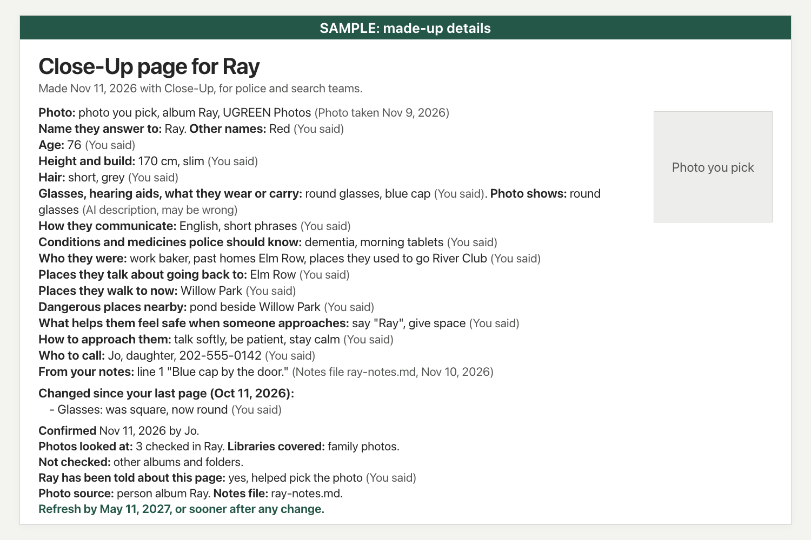

# Close-Up

When you ask, Close-Up makes the page you'd hand to police if someone with dementia went missing, with a recent close-up photo you pick, from the family photos on your UGREEN NAS.

Close-Up is a Markdown-only Skill for Uliya, the assistant on UGREEN AI NAS. It is my entry in the UGREEN Hackathon 2026 on AI NAS. Write-up: https://devpost.com/software/close-up

**Who it's for:** the son, daughter, husband or wife caring for someone with dementia at home, whose family photos are on a UGREEN NAS.

**Tested on made-up cases, not yet on a NAS:** On 39 test cases, the same AI model without Close-Up made 83 counted harms, such as saving a page the caregiver never saw in full. With Close-Up it made 3 on the pre-registered run and 1 on the final run.

**Check it yourself, no NAS needed:** [](https://github.com/StephenSook/close-up/actions/workflows/ugreen-checker.yml)

Every push downloads UGREEN's own Skill kit 0.7.7 from the official starter-kit link, checks the kit's SHA-256, and runs UGREEN's checker on the folder inside the exact ZIP I submitted ([release/close-up.zip](release/close-up.zip), SHA-256 `7898288adbaaaad3374bf0c0bdeee4ca9bf237675d5eb4071554ac6bbf92424f`). The job fails on any error or warning. The latest result is 0 errors and 0 warnings.

To run the same check on your own computer, from a clone of this repo (needs Node, and the CI uses Node 22):

```sh
curl -fL -o kit.zip "https://cdn.shopify.com/s/files/1/0630/9416/1602/files/uliya-skill-kit-0.7.7-en.zip?v=1794462613"
echo "e3a9c6a7b80b5790865aa1eea310a942904993693a021888b5f9d580f35d8a67  kit.zip" | shasum -a 256 -c -
unzip -q kit.zip
unzip -q release/close-up.zip -d rel
node uliya-skill-kit/scripts/check-skill.mjs rel/close-up
```

The checker prints JSON. Look at `summary.errors` and `summary.warnings`: both are 0.



*A sample page. Every detail on it is made up.*

## Why

In Xi'an in 2019, a 78-year-old woman with Alzheimer's went for a walk and couldn't remember her address. Her family searched all night, showing her photo to strangers. She was found the next day at a rescue center, about 9 km away (CGTN, 2020).

The Alzheimer's Association says six in 10 people living with dementia will wander at least once, and it tells families to keep a recent, close-up photo on hand to give to police. Here in Cobb County, where I go to school, Marietta police reach out to caregivers every six months to update their registry. Six months is a long time when someone's glasses, hair or walks change, and the newest photos are all over everyone's phones.

## The people who shaped it

- **A search-and-rescue leader in Georgia** told me: "Don't look for them first. Call the police first." So when someone is missing, the first thing Close-Up says is "Call the police now, before you start looking". He also said "The photo needs to be as fresh as possible," and "You have to know who that person was, not who they are now," which is why the page asks about old names, old jobs, old homes and places they used to go. On a second call I showed him a sample page with made-up details. He wouldn't cut anything, and said, "I wish someone would hand me that."
- **A Cobb County police sergeant in Community Affairs** sent me the list officers need: full name and date of birth, a recent photo, a detailed description of what they were last seen wearing, familiar places, places they may be drawn to, and medical conditions. He added that clothing also shows safety risk in cold months. Close-Up now asks for full name and date of birth, whether they're dressed for the weather, and any tracking program like Project Lifesaver.
- **A 2025 study led by KSU researchers** (Akintomide, Zhang and others, OBM Geriatrics) interviewed 15 dementia caregivers and found that the training and support meetings they learn from leave them needing to memorize and recall information. Close-Up writes down the details police need ahead of time, so in the first minutes, with a saved page, the main question is what they're wearing today.

Names and full quotes are in the Devpost write-up.

## What it does

- Searches the caregiver's photos on the NAS, starting from the person album UGREEN Photos already made, then checks up to nine with the NAS's local vision model for one clear, front-facing face.
- Shows up to three photos, each with the reason it was shown. The caregiver picks one. Its steps leave the pick to them.
- Reads the last page word for word and asks what changed, like new glasses or a new place they walk to. Each change is a yes or no.
- Saves a new dated page after the caregiver approves it, then, if the album step works, an album with the picked photo, which waits for approval too. Old pages stay. You print the page with the full-size photo it names.
- When someone is missing, it says to call the police first, then, if there's a saved page, points you to it right away, to print or show police, asks what they're wearing today, and can help check a camera on the NAS for which way they went.
- If a first thing police ask for is missing, a calm-time page ends with a line naming it, like "Still needed for police: full name and date of birth". Its steps list only what is missing from the page, never a guess.
- If it can't find something, it says so. Its steps tell it never to fill a gap with a guess.

## How it works

A Uliya Skill is plain Markdown. Uliya reads [SKILL.md](close-up/SKILL.md), asks the caregiver its questions itself, and hands each read and write to one of its local expert agents. SKILL.md has 13 delegations to five of the six experts. These are the catalog actions I expect each step to use (from [install-and-removal.md](close-up/references/install-and-removal.md)):

| Step | Expert | Expected actions | Effect |
|---|---|---|---|
| Find the pages folder | file-agent | file-workflow get-user-dir | read |
| Read the last page | file-agent | ug-filesystem ls, cat | read |
| Read a notes file | document-agent | ug-document qa (the caregiver's request, word for word, as the question) | read |
| Find and check photos | photo-agent | ug-photo figure-albums, search-picture, meta, vision-vlm | read |
| Photos from a folder | file-agent, photo-agent | ug-filesystem find, ug-photo meta, vision-vlm | read |
| Save the page | knowledge-agent, file-agent | ug-knowledge save-text after approval, then a read-back | write, then read |
| Make the album | photo-agent | ug-photo search-picture for the picked file name, create-album from that result (source-ref) after approval, then albums and album-detail | read, write, then read |
| Camera check (missing only) | security-monitor-agent | ug-surveillance cameras, event-timeline, event-evidence | read |

Never asked for: identity lookups, face lists, known or stranger labels, photo timelines, folder creation, moves and deletes. Each expert picks its own actions, so this is what the steps ask for, not yet checked on a NAS.

## What's in the package

| File | What it holds |
|---|---|
| [SKILL.md](close-up/SKILL.md) | The steps, each delegation, and what to do on every end state |
| [first-run-questions.md](close-up/references/first-run-questions.md) | The questions, asked once |
| [page-format.md](close-up/references/page-format.md) | The page, line by line, with a source on every content line |
| [messages.md](close-up/references/messages.md) | The 37 numbered messages |
| [limits.md](close-up/references/limits.md) | What it can't do |
| [testing.md](close-up/references/testing.md) | How it was tested and what is not verified. The cases and results are in the evidence folder |
| [sources.md](close-up/references/sources.md) | Where each rule came from |
| [install-and-removal.md](close-up/references/install-and-removal.md) | Setup, the expected actions, removal |
| [disclosures.md](close-up/references/disclosures.md) | AI tools used, third-party components (none), test data |

## How I tested it

UGREEN's official checker runs on every push (the badge above). I dry-ran 40 test cases, every example prompt in SKILL.md among them. A small model (Claude Haiku) played Uliya, and the experts answered with written replies, mostly from a test world Codex wrote without reading the package. In the final pass, 36 of 40 runs passed every graded check. Of the other 4, C01 sent its page-saved message twice, C12 left a change off its list on a refresh and saved nothing (a package gap, open for Round 2), C27 wrote an expert reply that answered no request, and C28 stopped early after marking a given answer as missing. The C27 runner had also used a tool its instructions ruled out, so after seeing the fail I reran it once, and the rerun passed. Both runs are published. Reading the runs by hand found two more problems, in C15 and C17, listed in RESULTS.md. In all 37 runs that saved a page, the page text sent to be saved matched the approved preview line for line. The same model without Close-Up, on the same 39 cases, made 83 counted harms in 34 of 39 runs, among them 34 saves of a page the caregiver never saw in full and 27 writes sent again after an approval request. 47 more of its checks could not be made, because those runs gave no page text. Counted the same way, Close-Up made 3 on the pre-registered run and 1 on the final run, each in a single run. No planted prescription or ID number reached a page. Codex and Grok reviewed the package in 95 rounds and found 295 issues. Of the 116 with a written verdict, I fixed 101 in full or in part and declined 15, each with the reason written down. [The ledger](evidence/fixtures/close-up/rounds/LEDGER.md) recounts every round from its files. The last round found nothing. Testing and review found 56 defects: 54 are fixed and 2 are open for Round 2, each listed with its fix or its plan in the evidence folder's DEFECTS.md. That's a fixture test, not device evidence. Nothing has run on a real UGREEN NAS yet.

## Where it could go wrong

- **The wrong photo.** Vision can misread a face, so the caregiver picks the photo and approves the whole page before it is saved.
- **An old page.** Every page carries the date it was last confirmed and by whom. A full page also has a refresh-by date.
- **Privacy.** Close-Up's own steps call no outside service and have no sync or sharing step. Before it reads anything in calm time, it asks you to confirm Uliya's local model is on. In an emergency it says so and doesn't wait.
- **A page about a real person.** The opening questions include "Have they been told about this page, and did they have a say in it?"

## Sources

- CGTN, June 17 2020: https://news.cgtn.com/news/2020-06-17/App-developers-help-find-missing-persons-through-crowdsourcing--RopozAARAQ/index.html
- Alzheimer's Association, Wandering: https://www.alz.org/help-support/caregiving/stages-behaviors/wandering
- Spectrum News, Marietta Vulnerable Person Registry: https://spectrumlocalnews.com/ga/georgia/news/2026/09/03/marietta-pd-urging-caregivers-to-enroll-in-vulnerable-person-registry
- Akintomide, Zhang, Iwuagwu and Ramos, "Experiences and Support Needs of Informal Caregivers in Managing Behavioral Symptom of Dementia", OBM Geriatrics, 2025: https://doi.org/10.21926/obm.geriatr.2502306
- An interview with a Georgia search-and-rescue leader (Nov 11 2026) and an email from a Cobb County police sergeant (Nov 12 2026), both named with permission in the Devpost write-up

## AI tools

I used Claude Code, Codex and Grok for research, drafting and review, and Claude and Codex for the dry-run tests. This README and the CI workflow were drafted with Claude Code. Every tool used for the package and what it did is listed in [disclosures.md](close-up/references/disclosures.md).

## License

[MIT](LICENSE). UGREEN's Skill kit is not included here. The CI downloads it from UGREEN's official link on each run.
